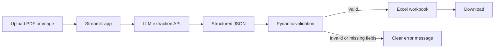

# Invoice Data Extractor

A small Streamlit app that turns a PDF or image invoice into structured, validated data and a downloadable Excel workbook. It uses an LLM to read invoice layouts while Pydantic ensures the result follows an explicit schema.

## Problem statement
Manually copying vendor, invoice, and line-item details from invoices is repetitive and error-prone. This project provides a lightweight workflow for extracting those fields and exporting them for bookkeeping or review.

## Features
- Upload PDF, PNG, JPG/JPEG, or WebP invoice files.
- Extract vendor name, invoice number, invoice date, total, and line items with an LLM API.
- Validate structured JSON with Pydantic and report missing required fields.
- Download a formatted Excel workbook with invoice details and a separate line-items sheet.
- Keep API credentials in an environment variable; no key is stored in source code.

## Flow


## Setup
Requires Python 3.10 or newer and an OpenAI API key.

1. Clone the repository and enter its directory.
2. Create and activate a virtual environment:
   ```bash
   python -m venv .venv
   source .venv/bin/activate  # Windows: .venv\Scripts\activate
   ```
3. Install dependencies:
   ```bash
   pip install -r requirements.txt
   ```
4. Copy `.env.example` to `.env` and set `OPENAI_API_KEY` to your API key. Keep `.env` private; it is excluded by `.gitignore`.
5. Start the app:
   ```bash
   streamlit run app.py
   ```
6. Upload an invoice and choose **Extract invoice data**. Review the extracted values and download the workbook.

For deployment, configure `OPENAI_API_KEY` in the host's secret/environment-variable settings instead of committing a `.env` file.

## Tests
Run the parsing tests with:
```bash
pytest
```

## Demo placeholders
- **Application screenshot:** _Add screenshot here._
- **Short demo video:** _Add demo link here._
- **Sample invoice:** [`samples/fake_invoice.md`](samples/fake_invoice.md) (fictional data)

## Limitations
- Extraction quality depends on scan clarity, layout, handwriting, and the model; always review results before using them for accounting.
- Required fields (vendor, invoice number, date, and total) must be present for export; invoices without them produce a clear error.
- The current implementation sends the uploaded document to the configured LLM provider. Do not upload sensitive documents unless your privacy and compliance requirements allow it.
- Currency is preserved as a numeric amount, but the currency symbol/code is not separately normalized.
- The sample invoice is Markdown for easy inspection; supported upload formats are PDF and common image formats.
